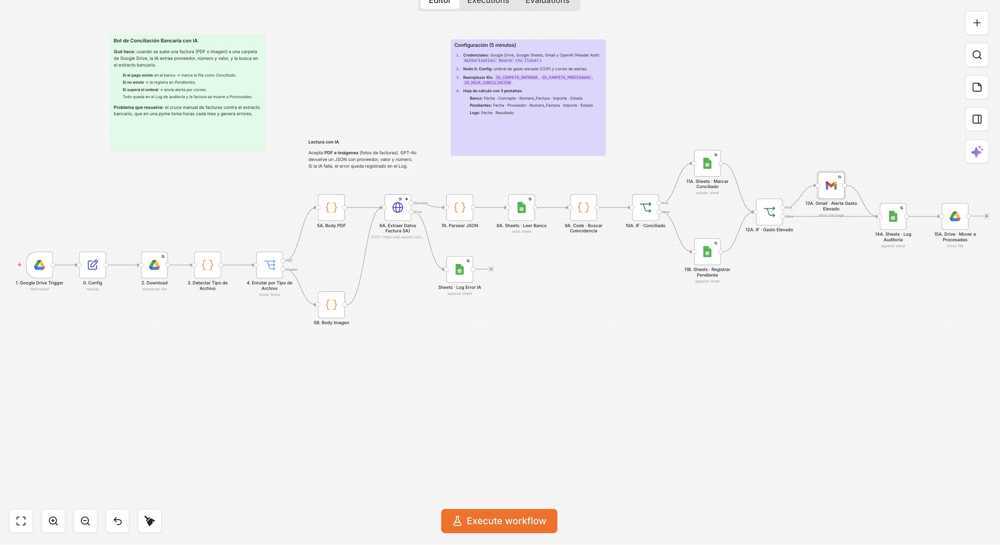

# Conciliación bancaria con IA

Cuando se sube una factura (PDF o foto) a una carpeta de Google Drive, la IA extrae sus datos y la busca en el extracto bancario.

## Problema que resuelve
Cruzar a mano cada factura contra el extracto del banco toma horas cada mes y es fácil equivocarse.

## Cómo funciona
1. Detecta la factura nueva en Google Drive.
2. GPT-4o lee el PDF o la imagen y devuelve proveedor, número y valor.
3. Busca el pago en la hoja del extracto bancario.
4. **Si el pago existe:** marca la fila como *Conciliado*. **Si no:** la registra en *Pendientes*.
5. Si el valor supera el umbral configurado, envía una alerta por correo.
6. Deja todo en un log de auditoría y mueve la factura a *Procesadas*.

## Cómo usarlo
1. Importa `workflow.json` en n8n.
2. Asigna credenciales de Google Drive, Google Sheets, Gmail y OpenAI.
3. En el nodo **0. Config**, define el umbral de gasto elevado y el correo de alertas.
4. Reemplaza `ID_CARPETA_ENTRADA`, `ID_CARPETA_PROCESADAS` e `ID_HOJA_CONCILIACION`.
5. Crea las pestañas **Banco**, **Pendientes** y **Logs** con las columnas indicadas en la nota del flujo.
