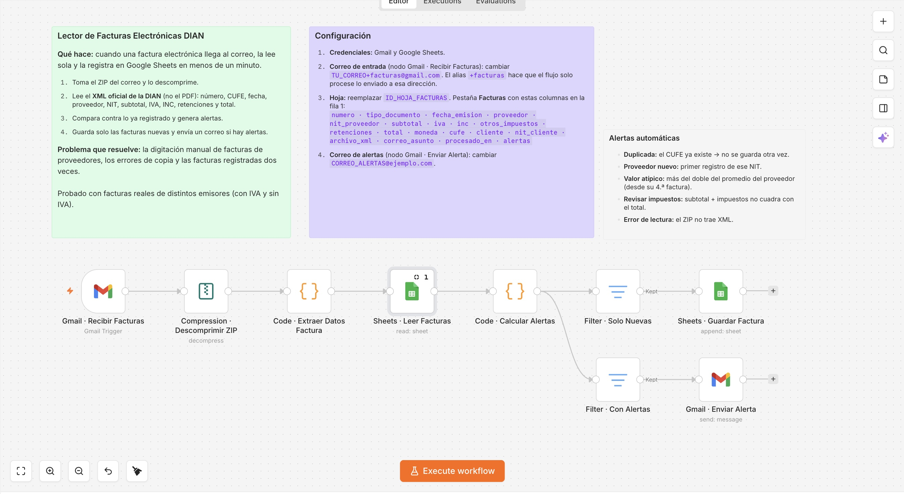
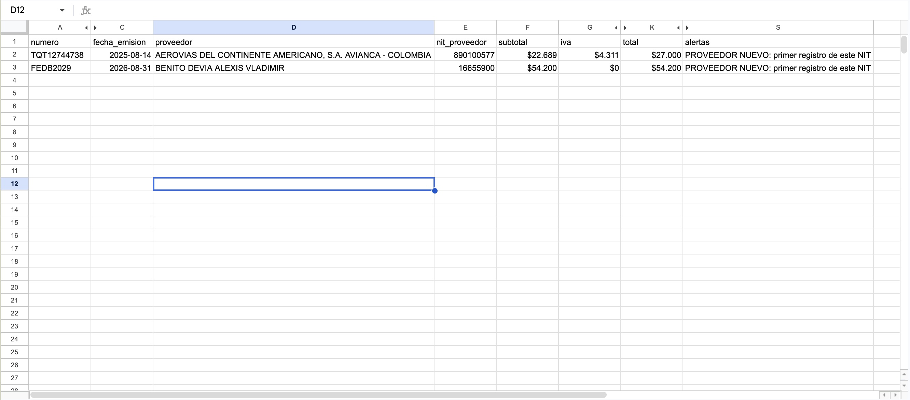
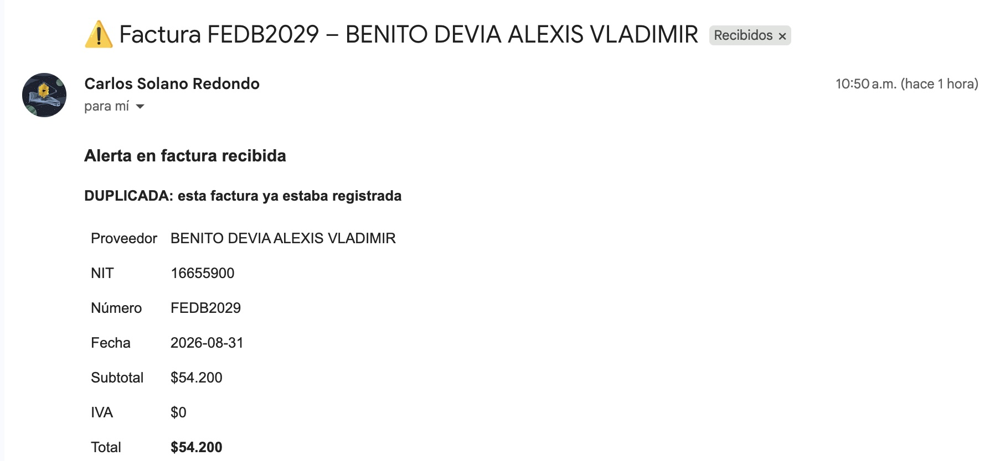

# Lector de facturas electrónicas DIAN

Cuando una factura electrónica llega al correo, el flujo la lee y la registra en Google Sheets en menos de un minuto.

## Problema que resuelve
En muchas pymes alguien descarga cada factura de proveedor del correo y la copia a mano en Excel o en el software contable. Eso cuesta horas cada mes, genera errores de digitación y facturas registradas dos veces.

## Cómo funciona
1. Revisa el correo cada minuto y toma las facturas con ZIP adjunto.
2. Descomprime el ZIP y lee el **XML oficial de la DIAN** (no el PDF), así los datos son exactos.
3. Extrae número, CUFE, fecha, proveedor, NIT, subtotal, IVA, INC, retenciones y total.
4. Compara contra lo ya registrado y genera alertas.
5. Guarda solo las facturas nuevas y envía un correo si hay alertas.

## Resultado en Google Sheets

## Alertas automáticas
| Alerta | Cuándo salta |
|---|---|
| Duplicada | El CUFE ya existe; no se guarda otra vez |
| Proveedor nuevo | Primera factura de ese NIT |
| Valor atípico | Más del doble del promedio del proveedor (desde su 4.ª factura) |
| Revisar impuestos | Subtotal + impuestos no cuadra con el total |
| Error de lectura | El ZIP no trae XML |

Probado con facturas reales de distintos emisores y sistemas de facturación, con IVA y sin IVA.

## Cómo usarlo
1. Importa `workflow.json` en n8n.
2. Asigna tus credenciales de Gmail y Google Sheets.
3. Cambia `TU_CORREO+facturas@gmail.com`, `ID_HOJA_FACTURAS` y `CORREO_ALERTAS@ejemplo.com`.
4. Crea la pestaña **Facturas** con las columnas indicadas en la nota del flujo.
